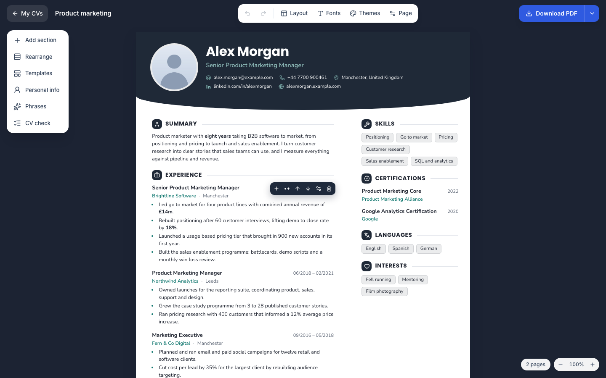
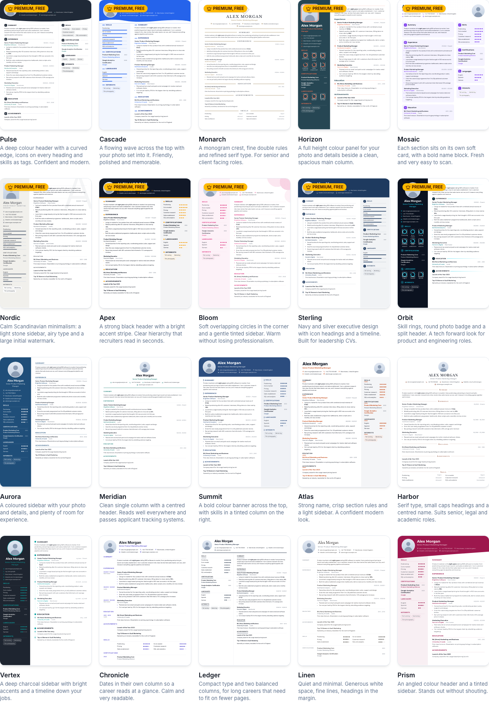

# CV Studio

Build a professional CV by typing straight onto the page, with twenty templates (ten of them
premium designs, all free) and a clean PDF download.
Free, private (CVs stay in the browser) and no sign up.



## What it does

- **Landing page and template gallery** at `/` and `/templates`.
- **My CVs dashboard** at `/dashboard`: every CV with a live thumbnail. Create (from a worked
  example or a blank page, in any template), open, rename, duplicate, download a copy, delete,
  and import a saved copy.
- **Editor** at `/editor/<id>`, where you **type straight onto the CV**:
  - Click any text on the page to edit it. `Enter` in a bullet starts the next one (splitting
    at the caret), `Backspace` on an empty bullet removes it, `Cmd B`, `Cmd I` and `Cmd U` format
    bullets and summaries, pasting keeps plain text.
  - Hover a section heading for its toolbar: add an entry or item, move up or down, move between
    sidebar and main column, hide, delete. Hover an entry for its own: add below, add a bullet,
    move, choose which parts show (organisation, location, dates, description, bullets,
    "I am still here"), delete. Click skill dots, bars or rings to set a level. Click the photo
    to change it.
  - **Top toolbar**: undo and redo, **Layout** (one column or a sidebar on either side, sidebar
    width, photo, job title, contact and heading icons, photo shape), **Fonts** (18 fonts for
    headings and body, size, line and letter spacing), **Themes** (16 two colour themes, custom
    colours, six page backgrounds), **Page** (A4 or Letter, spacing, margins, six skill level
    styles), and **Download** (PDF, a .json copy, duplicate).
  - **Tool card**: **Add section** (15 section types), **Rearrange** (drag to reorder, move
    between columns, hide and show), **Templates** (all 20 drawn with your own CV, with filters),
    **Personal info** (photo and contact details), **Phrases** (ready made bullets dropped into
    the job you were editing) and **CV check** (a score with a reason for every point).
  - Real pages: long CVs flow onto further pages, a job's later bullets carry over rather than
    leaving a gap, and a heading never sits alone at the bottom of a page.

## Templates

Twenty templates, every one free. The ten marked premium are the kind of design other builders
charge for: icon headings, curved and wave headers, monograms, timelines, skill rings, card
layouts and decorative backgrounds.

| Premium | | |
|---|---|---|
| **Pulse** curved dark header, icon headings | **Cascade** wave header with photo | **Monarch** monogram crest, serif, double rules |
| **Horizon** full height photo panel, timeline | **Mosaic** sections on soft cards | **Nordic** stone sidebar, initial watermark |
| **Apex** black header, accent stripe | **Bloom** soft circles, tinted sidebar | **Sterling** navy executive, icons, timeline |
| **Orbit** dark tech sidebar, skill rings | | |

| Classic | | |
|---|---|---|
| **Aurora** colour sidebar with photo | **Meridian** centred, one column, ATS friendly | **Summit** colour banner, right column |
| **Atlas** big name, light sidebar | **Harbor** serif, small caps, executive | **Vertex** charcoal sidebar, timeline |
| **Chronicle** dates in their own column | **Ledger** compact, two columns | **Linen** minimal, headings in the margin |
| **Prism** angled colour header | | |



## Running it

Needs Node 20 or later.

```bash
npm install
npm run dev
```

Then open http://localhost:3000.

```bash
npm run build && npm start      # production build
```

It deploys to Vercel, Netlify or any Node host as a normal Next.js app. Every page except the
editor is static.

## Checks

```bash
npm run typecheck
npm run lint
npm run build
npx playwright install chromium   # once
npm run test:e2e                  # starts the built app on port 3210 and drives it
```

`tests/e2e.spec.mjs` runs in a real browser: the landing page, creating CVs, typing on the page,
undo and redo, Enter and Backspace in bullets, bold, the section and entry toolbars, adding,
hiding and rearranging sections, themes, backgrounds, fonts, layouts and skill styles, all twenty
templates keeping the content, phrases, long CVs flowing onto more pages with nothing
overflowing, the PDF having one A4 page per sheet, reload, rename, duplicate, delete, download
and import (including files from the first version and old `.cvjson` files), blank CVs, and no
sideways scrolling on a phone.

## PDF

**Download PDF** opens the browser's print dialog with the page size already set, and only the
CV is printed. Choose **Save as PDF**. The text stays real, selectable text that applicant
tracking systems can read, and colours print even with *Background graphics* switched off.

A one click download with no dialog would need a server that renders the same page in a
headless browser (Playwright, as the tests use) and returns the file. That is a natural paid or
signed in feature later.

## How it is built

- **Next.js 16** (App Router), **React 19**, **TypeScript**, **Tailwind CSS 4**.
- **zustand** keeps the library of CVs in local storage, with undo history for the open CV.
- **dnd-kit** for drag to reorder, **lucide** for icons, fonts through `next/font`.

| Path | Holds |
|---|---|
| `src/lib/types.ts` | the CV document: personal details, sections, design |
| `src/lib/templates.ts` | the twenty templates and the colour themes |
| `src/lib/rich.ts` | the small rich text format (bold, italic, underline) |
| `src/lib/sample.ts` | the example CV, blank CV and new section helpers |
| `src/lib/store.ts` | the library of CVs, saving, undo and redo |
| `src/lib/io.ts` | download and import, and bringing older saves up to date |
| `src/lib/score.ts` | the CV score |
| `src/lib/phrases.ts` | ready made phrases |
| `src/components/cv/` | turns a CV into pages: blocks, measuring, pagination, editing on the page |
| `src/app/cv.css` | how every template looks, one block per template |
| `src/components/editor/` | the editor: toolbars, panels, drawers, what each button does (`ops.ts`) |
| `src/components/Dashboard.tsx` | My CVs |
| `src/app/page.tsx` | the landing page |
| `standalone/` | the earlier single HTML file version, still working on its own |

**Templates are a layout plus a look.** `templates.ts` says where the columns go and where the
name sits; `cv.css` styles it under `.tpl-<id>`. The same document feeds every template, which
is why switching never loses content. To add one, add an entry to `TEMPLATES` and a block of CSS.

**Editing on the page.** Every piece of text in a template is an `<Ed>` (`src/components/cv/edit.tsx`)
with a path such as `bul:<section>:<entry>:<n>`. In the editor it becomes contenteditable and
reports changes by path; `ops.ts` writes them into the document. The measuring copy of the page
renders the same markup and placeholders but is never editable, so pagination sees exactly what
you see. When typing pushes a block onto the next page, the caret follows it.

**Pagination.** The CV is cut into small blocks (a heading with its first entry, then each later
bullet), every block is measured off screen, and blocks are dealt onto pages column by column.
Page capacity is read from empty measuring pages, so templates can pad their columns however they
like. Fonts loading or a photo arriving trigger a re-measure.

## Accounts and payments

Nothing needs a server today. To run CV Studio as a product with sign in and paid extras:

**Accounts and sync.** Add an auth provider (Supabase Auth, Clerk or Auth.js) and a `cvs` table
with `id`, `owner_id`, `title`, `data` (JSON), `design` (JSON), `created_at` and `updated_at`,
protected so each person reads only their own rows (row level security on Supabase). All storage
goes through `src/lib/store.ts`, so its actions become write through calls to that table, with
local storage kept as an offline cache. On first sign in, offer to upload the CVs already in the
browser. Move photos out of the JSON into file storage (Supabase Storage or S3).

**Payments.** Stripe Checkout for a subscription or one off purchase, a webhook that records the
plan on the account, and the app reading the plan to unlock features. Good candidates for paid
features are the ones that need a server anyway: sync across devices, one click PDF without the
print dialog, a shareable online CV link, cover letters, and AI help rewriting bullets.

**Before charging anyone.** A privacy policy and terms (a CV is personal data, and UK GDPR or
GDPR applies), real account deletion, backups, error monitoring, and your own domain and brand.

## The sample CV

Alex Morgan does not exist. The email is on the reserved `example.com` domain, the phone number
is in the `07700 900000` block Ofcom keeps aside for drama, and the portrait is a drawn
placeholder, not a photograph.
