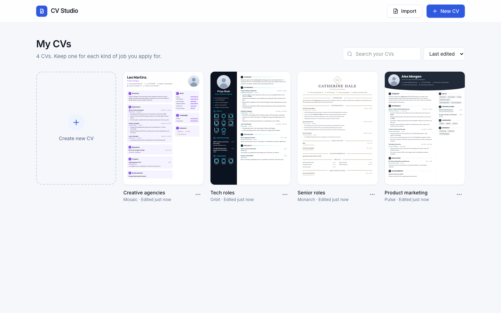

# CV Studio

A CV builder that lives in a single HTML file. A dashboard for all your CVs, ten templates,
colour schemes, photo upload, ready made phrases, live page checks, PDF and Word export. No server, no build step to run it,
no account, no watermark. Double click `index.html` and start typing.


## Why it exists

The online builders do the job but they charge a subscription to download a clean PDF, they keep
your details on someone else's server, and you cannot take the thing with you. This is the same
job done as one file you own. It opens from a folder, a USB stick or an email attachment, works
with the wifi off, and saves your work in the browser as you type.

## My CVs

The app opens on a dashboard of every CV you have made, each with a live preview of its first
page. Keep one per kind of job you apply for.



**New CV** asks for a name, a template, and whether to start from the example or a blank page.
Each card's menu opens, renames, duplicates, downloads a copy or deletes that CV, and you can
rename straight from the card or from the top of the editor. **Import a copy** brings a saved
`.cvjson` back in as a new CV. **My CVs** at the top of the editor takes you back.

Every CV is saved on its own, so changes to one never touch another. A CV saved by the earlier
single CV version is brought across the first time this version opens.

## Templates

Switching template keeps every word you have typed, so you can try all ten and pick.


| | | |
|---|---|---|
| **Classic** curved panel, sidebar left | **Modern** solid sidebar, caps headings | **Executive** colour banner, one column |
| **Professional** name left, contact right | **Minimalist** centred, airy, no colour blocks | **Creative** sidebar right, accent bars |
| **Timeline** rail and dots down the jobs | **Compact** two even columns for long CVs | **Elegant** serif, centred, small caps |
| **Bold** deep header with the photo in it | | |

## What it does

**Editing, straight on the page**
Click any line to change it. `Cmd B` for bold. `Enter` in a bullet starts the next one,
`Backspace` on an empty bullet removes it. Hover a row for its delete cross, hover a list for its
add button, hover a job or a section for arrows to move it and a cross to delete it. Click a
language dot to set the level, click a contact icon to swap it for one of fifteen others.
Empty fields show a faint dashed line so you can find them, and never print.

**Design**
Twelve colour schemes plus six of your own colour pickers. Twelve fonts, body and headings set
separately. Sliders for body size, heading size, name size, line spacing, section gaps, page
margins and sidebar width. Photo shape, size and zoom, and you drag the photo itself to move the
face inside its frame. Skills as dots, bars, tags or a plain list. Dates on the right, underneath
or hidden.

**Sections**
Drag to reorder. Move a section between the sidebar and the main column, hide it, or delete it.
Add work experience, education, courses, projects, profile, achievements, skills, languages,
certificates, hobbies, references, or anything custom.

**Ready made phrases**
Lines written for real trades: construction and site, electrical, drone and agriculture, driving
and warehouse, customer service, maintenance, teamwork, and profile openers. Click into a bullet,
then click a line to drop it in.

**Checks**
Page count, name, email, phone, profile length, whether each job carries enough detail, whether
bullets start with a doing word, blank boxes left behind, and a note on when a photo helps and
when to leave it off.

**Pages**
Long CVs flow onto more sheets on their own. A job that will not fit carries its last bullets
over rather than leaving half a page empty, and the sidebar artwork continues on later sheets.
**Fit** shrinks line spacing, then gaps, then type size, only as far as it needs to, to pull
everything back onto one page.

**Saving and export**
Autosave in the browser, each CV on its own, undo and redo with `Cmd Z` and `Shift Cmd Z`, save a copy to a file and
open it again later, export a clean HTML version with no editor around it, export a simple Word
file, and print to PDF.

## Printing

Choose **A4** and margins **None**. The colours come out either way: every coloured shape is drawn
as SVG, a border, or text, never as a CSS background, so nothing disappears when Chrome's
*Background graphics* box is left unticked. That one detail is the usual reason a CV prints out
plain white.

## Getting started

```bash
open index.html          # macOS
```

Nothing to install. Chrome gives the best print result.

## Building from source

`index.html` is generated. The parts are split up only to make editing comfortable.

```bash
python3 src/build.py     # writes index.html
```

| File | Holds |
|---|---|
| `src/1-paper-and-ui.css.html` | the CV styles and the editor chrome |
| `src/2-markup.html` | the panel and canvas shell |
| `src/3-engine.js.html` | data model, templates, renderer, pagination |
| `src/4-app.js.html` | typing, panel wiring, exports |
| `src/5-library.js.html` | many CVs, the dashboard, moving between pages, start up |
| `src/photo.jpg` | the picture the app starts with, embedded as base64 |
| `src/make-placeholder-photo.py` | draws that placeholder portrait |

The CV itself is a plain JSON document. Templates are render functions over that document, which
is why switching one never loses your content.

## Tests

Real browser, no mocks.

```bash
npm install
npx playwright install chromium
npm run test:all
```

`tests/studio.spec.mjs` covers editing, all ten templates, colours, sections, phrases, undo and
redo, the checks, fit to page, autosave across a reload, and that the PDF comes out as one A4 page
with background graphics switched off. `tests/dashboard.spec.mjs` covers the dashboard: bringing
an old CV across, creating, renaming, duplicating, deleting and importing, and that each CV keeps
its own content. `tests/multipage.spec.mjs` covers what happens past one
sheet: page counts on screen and in the PDF, bullets carrying over, sidebar art repeating, and
typing without losing the caret while the layout reflows.

## Where your CVs are kept

In the browser's local storage, under three kinds of key:

| Key | Holds |
|---|---|
| `cv-studio-index` | the list of CVs: id, name, template, created and edited times |
| `cv-studio-doc:<id>` | one CV, the same JSON that **Save a copy** writes |
| `cv-studio-thumb:<id>` | its first page as clean HTML, for the dashboard preview |

The address bar says where you are: `#/` is the dashboard, `#/cv/<id>` is one CV, and `#/edit`
opens whichever CV was edited last (making one from the example if there are none).

Local storage belongs to one browser on one device, and clearing site data clears it, which is
why the dashboard keeps suggesting **Download a copy**.

## Taking it further: accounts and payments

Nothing here needs a server today. If CV Studio is ever offered as a hosted product with
sign in and paid extras, this is what it would take.

**Accounts and sync.** The CV is already one JSON document per CV, which is the easy part. Add an
auth provider (Supabase Auth, Clerk or Auth0 all fit) and a table of `cvs` with `id`, `owner`,
`title`, `doc` (JSON), `thumb`, `created` and `updated`, protected so each person only reads their
own rows. `LIB` in `src/5-library.js.html` is the only code that touches storage, so it becomes a
thin client over that table, keeping local storage as an offline cache. On first sign in, offer to
upload the CVs already in the browser. Photos should move out of the JSON into file storage once
there is a server, since they are most of each document's size.

**Payments.** Stripe Checkout for one off or subscription purchases, with a webhook that records
the plan against the account, and the app reading that plan to unlock features. Keep the
promise in "Why it exists": a clean PDF of your own CV should stay free. Paid extras that fit are
things that need a server anyway, such as sync across devices, a shareable link to an online CV,
or more storage.

**Also needed before charging anyone.** A privacy policy and terms, since a CV is personal data
(UK GDPR applies); account deletion that really deletes; backups; and a hosted copy of the app
rather than a file, so it can be updated. The single file can still be the build output and served
as a static page.

**PDF.** Today's PDF comes from the browser's print dialog, which gives selectable text and exact
layout at no cost. A one click download without the dialog would need a headless browser on a
server, the same Playwright the tests use, rendering the clean HTML export to PDF.

## Layout

```
index.html                 the app, self contained: dashboard and editor
src/                       the parts it is built from, plus the build script
tests/                     browser tests
legacy/cv-editor.html      the first version, one template, kept for reference
examples/                  a finished CV as HTML and as PDF
docs/                      screenshots for this readme
```

## The sample CV

Everything the app opens with is invented. Jordan Blake does not exist, the portrait is drawn by
`src/make-placeholder-photo.py` rather than photographed, the email sits on the reserved
`example.com` domain, and the phone number is inside the `07700 900000` block that Ofcom keeps
aside for film and television, so neither can reach a real person.

To change the starting CV, edit `starterDoc()` near the top of `src/3-engine.js.html`, drop a new
`src/photo.jpg` in place, and run the build. Nothing else needs touching.
